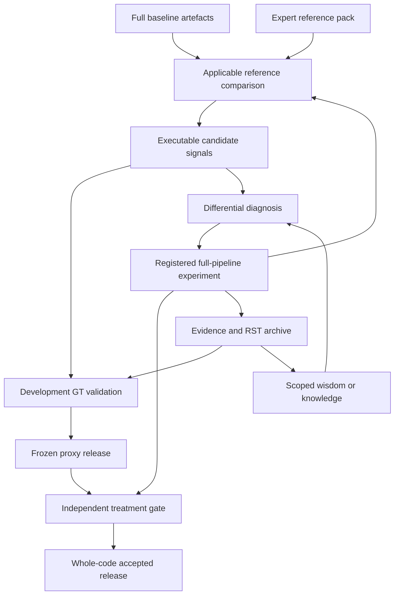

# CoLab_V2 instructions

How to build, run, and operate this workspace.

## Quick start

```bash
PYTHONPATH=src python -m unittest discover -s tests -v
PYTHONPATH=src python -m rsi4tun audit-code --root .
PYTHONPATH=src python -m rsi4tun demo --output /tmp/rsi4tun-example-001
```

Real SAM4Tun stages:

```bash
export PROXY4TUN_OUT_ROOT="$PWD/data/development/sample"
export PROXY4TUN_INPUT_TXT="$PWD/data/scans/sample.txt"
export PROXY4TUN_PARAMS_DIR="$PWD/configs/families/sample"
export PROXY4TUN_TUNNEL_META="$PWD/data/meta/tunnel_meta.json"
export PROXY4TUN_SUBSET="sample"
export PYTHONPATH="$PWD/sam4tun:$PWD/sam4tun/segment-anything"
./venv/bin/python sam4tun/run_stages.py baseline --out-root "$PROXY4TUN_OUT_ROOT" --input "$PROXY4TUN_INPUT_TXT"
```

Owned Python under `src/` and `tests/` stays free of comments and docstrings. Experiment-learned notes live under `dikw/knowledge/`; directory location alone does not accept a claim.

## Architecture

Status: normative specification. This document does not assert empirical success.

### One researcher, explicit controllers

A replaceable LLM researcher proposes measurement code, executable hypotheses, and source changes. Deterministic components execute comparisons, protect registered criteria, evaluate predictions, validate proxies, and manage releases. The researcher cannot make its own proposal acceptable by changing its evaluator.

Development can access labelled development cases. Deployment can access the new tunnel, approved expert references, the released proxy, and the public evidence archive. Deployment cannot open the new tunnel's ground truth. A separate final evaluator can compute mIoU after the study's decisions have been frozen.



The path from the archive to wisdom requires explicit knowledge and wisdom acceptance. It does not automatically promote every experiment. The validation path may defer a candidate when development coverage is insufficient.

### Components

| Component | Responsibility | Boundary |
| --- | --- | --- |
| `contracts.py` | Complete-run and provenance contracts | Reject incomplete decision evidence |
| `adapters.py` | Export every stage artefact and final 3D labels | Synthetic backend and real SAM4Tun adapter boundary |
| `evidence.py` | Measure artefacts and compare applicable reference conditions | No target-tunnel GT access |
| `proxy.py` | Construct comparison-derived features; fit a ridge model and gate proxy releases | Fit and validate only in development |
| `diagnosis.py` | Execute registered response models and assess predictions | Preserve both-match and neither-match outcomes |
| `orchestrator.py` | Register execution and apply frozen deployment decisions | No silent change to acceptance criteria |
| `versions.py` | Capture, execute, promote, and restore whole source revisions | An accepted revision must be the evaluated revision |
| `records.py` | Preserve RST and evidence links; control claim promotion | An experiment record is not accepted knowledge |
| `demo.py` and `cli.py` | Exercise the contracts on explicitly synthetic inputs | No research claims from fixture results |

### The complete pipeline is the experimental unit

Every decision-relevant run executes:

**Unfolding → denoising → enhancement → joint and K-centre localisation → prompt generation → SAM segmentation → semantic assignment → 3D reprojection.**

Artefacts from intermediate stages locate discrepancies. Final labels on the original point identities determine the development mIoU target. Fixing K-centre behaviour is useful only to the extent that the full process benefits. A shortcut ending at K-centre error cannot establish final segmentation improvement.

A failed stage produces a failed run with its partial evidence. It cannot produce an apparently successful proxy score. It may motivate a diagnostic experiment, but it cannot enter an operational acceptance comparison that requires a complete run.

### Comparisons precede diagnosis

An expert reference pack contains stage artefacts, coordinate and design metadata, expert review provenance, and measurement versions. It may contain several applicable design strata. It is not a universal image to imitate.

First establish comparability. Then compute a vector of observed measurements and deviations: depth coverage over expected support, missing-region structure, boundary support and independent-edge coverage, and registered K-centre consistency. Retain both reference values and observed values. A scalar score must not erase the discrepancy that motivated the next experiment.

The researcher derives candidate features from this vector and states their target connection, assumptions, and failure modes. A feature may be a direct measurement, a design-conditioned difference, or a stated combination. Its implementation, units, missing-value rule, and reference selection policy are versioned before diagnostic outcomes are observed.

The **candidate proxy is constructed before differential diagnosis**. It becomes an **acceptance proxy only after development validation**. If current development GT cannot validate it, keep it provisional. It can describe an anomaly and guide an experiment. The previously accepted proxy remains the deployment gate when applicable. If no valid gate covers the case, deployment can gather diagnostic evidence but must abstain from claiming an accepted performance improvement.

The executable `ProxyProposal` records the originating comparison, the incumbent proxy, the added feature definitions and the fitting rule before diagnosis. It specifies a refit of incumbent features plus the candidates; it contains no invented calibrated weights. The experiment plan binds its digest. Development subsequently fits and validates that specification, and the original frozen proxy remains the gate until a release passes.

### Differential diagnosis

Retrieve relevant accepted wisdom first, then tested knowledge, and then original evidence when needed. If nothing applies, state that the hypotheses are new. Do not manufacture a remembered rule.

Each hypothesis is an executable response model. It predicts what the **same registered intervention or set of interventions** will do to specified observations. An intervention is a code or configuration change; it is not itself a hypothesis.

For example, competing explanations may attribute K-centre inconsistency to deficient depth support or to an incorrect boundary-to-segment assignment. They should predict distinct responses to a depth-repair intervention and an assignment intervention. Both interventions can change several observables. Neither must serve as an artificial zero-effect arm.

Before execution, register the baseline revision, intervention revisions, controlled inputs, seeds, measurement versions, response intervals, rejection rules, and budget. Predictions use the units of their observables. Account for measured repeatability where relevant; do not reuse one arbitrary tolerance across metres, degrees, pixels, and ratios.

Run each arm from the same baseline snapshot. Execute the entire pipeline. Verify that the intended configuration change was actually applied and that the held-constant conditions remained fixed. Keep manipulation checks separate from predicted outcomes: an applied treatment with a null outcome can reject a prediction without being an invalid intervention. Preserve failed and rejected arms.

The supplied `preregister_and_execute` seals the before record before starting the versioned arm runs. It records the registration receipt, rejects pre-existing execution output directories and protected-evaluator changes, and derives manipulation evidence from the applied configuration differences bound to the input-stage digest. Artefact checks bind the numerical comparison inputs to recorded stage payloads and verify the final point labels against the final-stage artefact. These checks establish traceability inside the delivered execution contract; they do not replace the real adapter or operating-system isolation.

Exactly one compatible prediction supports that response model under the registered conditions. Both compatible or neither compatible is inconclusive. Support does not establish a unique physical cause. Several omitted explanations may produce the same response. Record that uncertainty.

### Three separate acceptance decisions

| Decision | Required evidence | Meaning |
| --- | --- | --- |
| Deployment treatment | Complete run, applicable frozen measurements and proxy, predeclared improvement and guardrails | Operational retention under indirect evidence |
| Development proxy | Comparison-derived features plus grouped development GT evaluation and useful mIoU decisions | Permission to use a new proxy on a later frozen episode |
| Knowledge or wisdom | Evidence-linked executable tests and stated scope; synthesis for wisdom | Permission to reuse a supported relation or decision principle |

A diagnostic arm can be informative while failing the deployment treatment gate. An accepted treatment can have an unresolved mechanism. A better proxy score does not prove higher mIoU on the unlabelled case.

Within an episode, compare scores under one proxy and one measurement release. A score increase beyond tolerance can retain a proposal; a decrease restores the previous accepted release; a tie stops exploitation. A tie may open a bounded diagnostic episode. Stop on a declared experiment budget, repeated inconclusive evidence, or lack of an admissible next experiment. Do not change thresholds to make the current result pass.

### Whole-code continuity

Each proposal has a complete source-tree identity. Its evaluation executes that exact revision in an isolated worktree. Acceptance points to the tested commit and tree, a recoverable bundle, pinned configuration, proxy and comparator identities, environment identity, external model/data hashes, and evidence receipts.

The operational pointer changes only after evaluation. Rollback moves that pointer to the preceding accepted revision and reruns or restores its compatible artefacts. A natural-language description, a diff alone, or a remembered parameter list is insufficient.

The complete snapshot includes the evaluator's code for reproducibility. Its trusted running copy and release identity remain protected from candidate edits. Changes to a comparator, reference selector, active proxy, or acceptance gate require a new development release and an episode boundary. Scores produced by incompatible releases cannot be directly compared.

### Development coverage and final evaluation

Use grouped splits that prevent overlapping rings or near-duplicate configurations from appearing on both sides of validation. Keep feature construction, scaling, and fitting inside the training side. Select candidates without inspecting a final audit set. Repeated adaptive use of the same held-out set is development feedback, not independent final evaluation.

Evaluate proxy fidelity and the final mIoU of the configurations its policy selects, under the same search budget as the incumbent. A better numerical proxy fit alone is insufficient. Include cases that could improve reference resemblance while damaging semantic identity or final labels.

The delivered `proxy.py` fits a standardised ridge model using training rows only. Its validation gate checks disjoint case/group identities, fitting provenance, a minimum number of held-out groups, active newly proposed features, predictive-error non-degradation, and the mIoU change of selected configurations against the incumbent. For a first proxy, predictive error is compared with the training-mean predictor and selections with each held-out case's declared baseline. The code compares models on the same supplied candidate pool. The real experiment driver must still enforce equal candidate-generation budgets. This gate does not implement an ablation study or establish a scientific generalisation claim.

If an applicable tunnel condition is absent, first inspect existing development coverage. If the gap matters to the next decision, request one representative labelled subset with a declared coverage purpose. Once labelled and used for development, that subset is no longer unseen evaluation data. Repeated metric rejection alone does not justify acquiring labels.

These rules specify research discipline for executable evidence work; they do not establish the novelty or effectiveness of the resulting method.

## Evidence and RST records

### Meaning and scope

This workspace uses **Research State Transition (RST)** as a working name for the record connecting a registered research state to its observed outcome and next action. This expansion defines the local schema; it does not assert that an attached article uses the same acronym.

An RST record preserves evidence and decisions. It is not a transcript of internal reasoning, a natural-language substitute for code, or an automatic knowledge claim. Keep explanatory text in `dikw/knowledge/` and link it through `knowledge_ref`. Keep full code in the immutable source revisions that the record names.

`records.py` implements an immutable before record and a separate after record. `preregister_and_execute` in `orchestrator.py` seals the plan before starting the actual versioned arm runs, binds the registration receipt, and rejects pre-existing output directories and protected-evaluator changes. `verify_preregistration` checks both record and plan digests. `append_outcome` links the result to that before record, checks the planned arm commits, and creates a new file without overwriting the previous one.

### Record fields

| Record | Machine-readable content | Purpose |
| --- | --- | --- |
| Before | Campaign and protocol identity; synthetic status; comparison and candidate-signal paths; complete plan; plan digest; retrieved claim identities | Establish what existed and was predicted before execution |
| Plan | Baseline run and commit; comparison, signal, proxy, and evidence-contract digests; arm commits and trees; executable hypothesis entrypoints and source hashes; parameters; prediction intervals; units; manipulation checks | Bind the scientific comparison to exact executable versions |
| After | Before digest; plan digest; diagnosis; run identities; arm commits; treatment decisions; next action code; knowledge reference | Preserve what occurred and the ensuing action |
| Warning | Rejected operator identity, condition and evaluator identities, failed run and decision links | Prevent an identical failed retry under the same condition and frozen evaluator |
| Coverage event | Reference and observed design identities; comparison status; available development coverage; selected next action | Explain abstention without fabricating a quality score |

Deployment records reject protected GT fields. This is a record-level guard. Production deployments still require process and storage isolation. Private development evaluation records stay outside the deployment archive.

### Example 1: a discriminative experiment

**Synthetic fixture only.** This example tests implementation plumbing. It does not establish a tunnel mechanism, a proxy–mIoU relation, or segmentation improvement.

The baseline comparison has three relevant features. The boundary feature is selected as a new candidate before hypothesis design. It is absent from the active fixture proxy:

| Comparison feature | Baseline |
| --- | ---: |
| `depth_valid_coverage__delta` | −0.25 |
| `k_phase_rms_turns__delta` | +0.20 |
| `boundary_symmetric_distance_fraction__delta` | +0.05 |

Arm A repairs the fixture's three missing depth columns. Arm B applies a phase correction of 0.05 turns. Both run from the same baseline. The two programs predict **both arms**; the arms are not themselves the hypotheses.

| Program | Arm | Predicted depth response | Predicted K response | Predicted boundary response |
| --- | --- | ---: | ---: | ---: |
| `hypotheses.depth_limits_k` | A | +0.25 | −0.10 | −0.025 |
| `hypotheses.depth_limits_k` | B | 0 | −0.05 | −0.0125 |
| `hypotheses.phase_limits_k` | A | +0.25 | 0 | 0 |
| `hypotheses.phase_limits_k` | B | 0 | −0.05 | −0.0125 |

Each centre has a registered interval half-width of 0.005 in the corresponding units. These widths are demonstration parameters, not measured uncertainty. The model definitions and scope are in [the hypothesis note](dikw/knowledge/hypotheses/depth_vs_phase.md).

The observed synthetic responses, in the table's metric order, are A: `(+0.25, −0.10, −0.025)` and B: `(0, −0.05, −0.0125)`. Their resulting boundary differences are +0.025 and +0.0375. The first prediction matches and the second fails. The recorded diagnosis is `h1_supported`; `causal_status` remains `unconfirmed`. The agreement of both models on B does not invalidate the discrimination supplied by A. Other explanations remain possible.

Manipulation validity comes from the configuration actually executed: A applies depth repair +0.25 and B applies phase correction +0.05. It is checked independently of the outcome. If a correctly applied intervention produces an unexpected null response, the hypotheses may fail; the experiment is not automatically labelled an invalid manipulation.

The boundary signal remains unvalidated. In this fixture it is proportional to K discrepancy, so it may be redundant. A discriminative response does not establish incremental predictive value for final mIoU.

The frozen fixture score is:

\[
P = 0.9 + 0.2\,d_{\mathrm{depth}} - d_{\mathrm{K}}.
\]

| Full run | Depth comparison | K comparison | Fixture score | Treatment result |
| --- | ---: | ---: | ---: | --- |
| Baseline | −0.25 | +0.20 | 0.65 | Starting release |
| A | 0 | +0.10 | 0.80 | Eligible and selected |
| B | −0.25 | +0.15 | 0.70 | Eligible, lower fixed score than A |

Selection uses the frozen rule, independently of which hypothesis matched. The accepted pointer advances to A's complete tested code revision. The arithmetic fixture is not a learned or validated research proxy. Any private synthetic mIoU calculation occurs only after deployment decisions have been fixed.

### Example 2: a failed treatment

**Synthetic fixture only.** Starting from accepted A, a follow-up proposal leaves six depth columns missing. Its comparison is `depth_valid_coverage__delta = −0.50` and `k_phase_rms_turns__delta = +0.30`. The frozen score is 0.50, below A's 0.80.

The treatment decision is `rollback`. The accepted release remains A. Preserve the failed run and its complete source revision. Save a warning keyed by the input condition, accepted baseline commit, frozen proxy, evidence contract, and operator. Do not reinterpret this result as evidence that every similar operator fails on every tunnel.

Repeating A's unchanged state gives an equal score and a `plateau` decision. That stops this exploitation episode. It does not prove a performance ceiling.

The warning and the failed arm are evidence. They are not automatically accepted knowledge or wisdom. A diagnosis may use them later only with their actual status and scope.

### Example 3: uncovered complex design

Suppose the available expert reference is scoped to a simple `1-1` lining design and the new tunnel is marked `5-1`. The comparison produces a `coverage_gap` before interpreting differences as defects. Do not fill in invented depth, boundary, K, or proxy values for that case.

Record the reference identity, the new design identity, the applicability decision, and the next action. If matching labelled development cases already exist, inspect that coverage. Otherwise, a justified and budgeted request can acquire one representative labelled subset. If the request cannot be satisfied, record `defer_unsupported_scope`.

New labels used to refit the method become development evidence. They do not preserve the same subset's status as an unseen evaluation case.

### Reading the generated records

Run the demo into a new output directory. The following paths are relative to that directory. The demonstration has been executed with the scores and decisions shown above; each new execution supplies its own actual identities.

| Generated path | Contents |
| --- | --- |
| `report.json` | Run summary, decisions, and generated evidence identities |
| `evidence/reference.json` | Synthetic expert-reference artefact bundle |
| `evidence/baseline_comparison.json` | Measurements and comparison-derived features before diagnosis |
| `evidence/candidate_signals.json` | Candidate signals linked to the baseline comparison |
| `evidence/candidate_proxy.json` | Comparison-derived proxy specification created before hypothesis design |
| `evaluator/proxy.json` and `evaluator/policy.json` | Frozen fixture evaluator and policy |
| `rst/synthetic_depth_vs_phase.before.json` | Sealed experiment registration |
| `rst/synthetic_depth_vs_phase.after.json` | Observed response checks and treatment decisions |
| `rst/warning.json` and `rst/plateau.json` | Failed follow-up and stopping evidence |
| `runs/reference/`, `runs/baseline/`, `runs/arm_a/`, and `runs/arm_b/` | Complete synthetic stage outputs |
| `runs/rejected_followup/` and `runs/plateau_repeat/` | Preserved rejected and tied runs |
| `archive/bundles/` and `archive/executions/` | Recoverable complete source revisions and execution receipts |
| `development_private/posthoc_fixture_audit.json` | Private synthetic GT evaluation after deployment decisions |

Use these generated files for their real hashes and commits. The documentation never supplies fabricated hash strings as verified evidence. The deployment process must not use the private post-hoc audit file to choose a treatment.

The RST and demonstration summary records carry `synthetic: true` and `learning_eligible: false`. Stage artefacts identify the `synthetic` backend. The knowledge gate rejects fixture evidence. The synthetic explanatory note is [here](dikw/knowledge/research_notes/synthetic_example.md).

## Workspace map

| Location | Contents |
| --- | --- |
| `src/rsi4tun/` | Contracts, adapters, evidence, proxy, diagnosis, orchestrator, versions, records, researcher, evaluation, quality, demo, cli |
| `configs/` | Comparison policies, evidence contract, protocol, verification digests, family parameter packs |
| `sam4tun/` | Parameterized stages 1–6, helpers, Segment Anything, ViT-H weight |
| `venv/` | Local Python environment with CUDA torch |
| `data/scans/` | Six-column labelled scans |
| `data/meta/` | Tunnel design-blueprint metadata |
| `data/development/` | Development run outputs |
| `data/deployment/` | Deployment run outputs |
| `dikw/data/` | Experiment data summaries |
| `dikw/information/` | Organised experiment information and source provenance |
| `dikw/knowledge/` | Hypotheses, claims, and provisional research notes |
| `dikw/wisdom/` | Standing principles synthesised from tested knowledge |
| `dikw/data/logs/` | Daily DIKW synthesis logs (not wisdom) |
| `tests/` | Evidence, validation, protocol, integrity, and source-version tests |
| `environment.lock.json` | Digests and substrate pins for the local environment |

Create run archives outside the source repository. The demo produces separate `runs/`, `evidence/`, `evaluator/`, `rst/`, `archive/` and `development_private/` directories. Real deployment must not mount the private development directory.

An accepted release identifies the complete code revision and its exact tree. Evidence archives and private data stay outside the source tree; their identities belong in the release manifest.

## Local environment

### Data layout

Scans live under `data/scans/` with six fields: coordinates, intensity, semantic label, and ring index. Stage scripts read only the columns they need (`usecols`). Shared tunnel meta lives under `data/meta/`. Development and deployment run outputs go under `data/development/` and `data/deployment/`.

`tunnel_meta.json` holds design-blueprint fields only: inner diameter, ring length, ring count, and orientation. It is keyed by subset id. Stage 1 loads these through `sam4tun/helpers/design_blueprint.py` and uses them for diameter, slicing ring count, ring-length checks, and drive orientation.

### Runtime pins

`venv/bin/python` resolves `segment_anything` under `sam4tun/segment-anything/`. Machine-readable digests live in `environment.lock.json`. The host may still supply `~/.pyenv` libraries via `RUNPATH`; those pins are recorded in the lock file.

The synthetic demo copies the source tree into a temporary worktree and excludes `venv/`, `sam4tun/segment-anything/`, `data/`, and other run archives so the fixture does not duplicate the local environment.

## Researcher prompt

Status: implementation instruction. This is not accepted scientific knowledge.

### Comparison and candidate signals

Start with the current complete run, its verified stage artefacts, the reference applicability report, and the active evaluator release. Read scoped accepted wisdom, then tested knowledge. If neither applies, state that the proposed explanation is new.

Identify a concrete measured discrepancy. Cite the artefact identity, comparison feature, executable extractor and code revision. Distinguish missing observations, representation loss, implementation failure, and a legitimate change in tunnel design. Do not turn an incompatible reference into an accuracy judgement.

Propose at most a small registered set of candidate signals. Give each signal an executable definition, input artefacts, units, valid scope, missing-value rule, target rationale and a plausible way to improve it without improving final mIoU. Put this explanation in a versioned document under `dikw/knowledge/`. Return the document reference and machine-readable identifiers to the controller.

Candidate signals must exist in a verified comparison report before diagnosis. A new transformation requires new extractor code and a newly computed report. Do not propose an unmeasured name and treat it as an observation. A candidate signal is not a validated gate. Development must calibrate and validate any new acceptance proxy.

### Differential diagnosis

Construct two executable response models for the same permitted interventions. Retain an open possibility that both models omit the relevant mechanism. Each model must state assumptions, expected responses, uncertainty and rejection conditions. Link its explanatory text to its tested code path.

Choose a discriminative intervention whose predicted responses separate beyond the declared measurement uncertainty. A two-arm experiment uses the same complete baseline and controlled inputs. Both arms may move the candidate metric. Avoid perturbing several unrelated stages unless the joint package is the specific operator under test.

Keep manipulation checks separate from outcome predictions. Verify that the intended configuration or code change was applied. Do not classify a genuinely null response as a failed manipulation solely because the predicted improvement did not occur.

Commit complete proposed revisions. Seal predictions and comparison identities before execution. Do not change units, intervals, feature definitions, masks, support edges, expected K positions or thresholds after seeing the outcome. The controller verifies execution and evaluates the registered response pattern.

### Evidence update

Preserve failed runs, null results, rejected interventions and contradictions. State whether the result supports one response model, both, neither, or cannot be interpreted because the manipulation or measurement failed. A retained treatment does not establish its causal explanation.

Write the machine-readable RST transition with references to a short explanatory note under `dikw/knowledge/research_notes/`. State the next decision the evidence changes. Stop at the predeclared budget or when no admissible next experiment remains. Do not call a plateau a proved ceiling.

### External knowledge

Use curated primary sources and project design documentation first. Search public literature only to resolve a specific missing concept or measurement choice. Do not put protected scans, unpublished results or private source text into search queries. Record the exact source, supported statement, scope and retrieval date in `dikw/information/sources/` or `dikw/knowledge/research_notes/`.

A paper motivates a candidate. It does not validate that candidate for SAM4Tun. Local executable evidence and development GT determine its admissibility.
