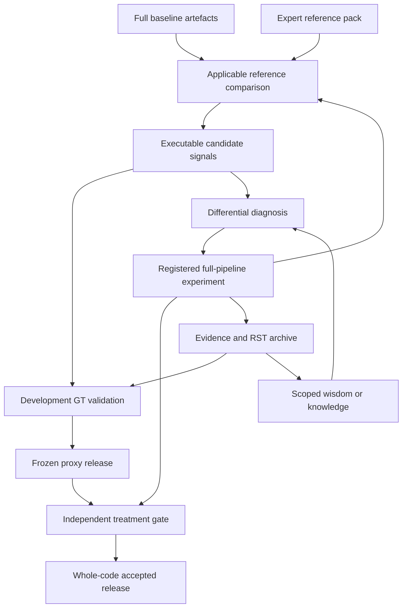

# Architecture

Status: normative specification. This document does not assert empirical success.

## One researcher, explicit controllers

A replaceable LLM researcher proposes measurement code, executable hypotheses, and source changes. Deterministic components execute comparisons, protect registered criteria, evaluate predictions, validate proxies, and manage releases. The researcher cannot make its own proposal acceptable by changing its evaluator.

Development can access labelled development cases. Deployment can access the new tunnel, approved expert references, the released proxy, and the public evidence archive. Deployment cannot open the new tunnel's ground truth. A separate final evaluator can compute mIoU after the study's decisions have been frozen.

The path from the archive to wisdom requires explicit knowledge and wisdom acceptance. It does not automatically promote every experiment. The validation path may defer a candidate when development coverage is insufficient.

## Components

| Component | Responsibility | Boundary |
| --- | --- | --- |
| `contracts.py` | Complete-run and provenance contracts | Reject incomplete decision evidence |
| `adapters.py` | Export every stage artefact and final 3D labels | Real adapter remains an integration task |
| `evidence.py` | Measure artefacts and compare applicable reference conditions | No target-tunnel GT access |
| `proxy.py` | Construct comparison-derived features; fit a ridge model and gate proxy releases | Fit and validate only in development |
| `diagnosis.py` | Execute registered response models and assess predictions | Preserve both-match and neither-match outcomes |
| `orchestrator.py` | Register execution and apply frozen deployment decisions | No silent change to acceptance criteria; live episode-budget driver remains an integration task |
| `versions.py` | Capture, execute, promote, and restore whole source revisions | An accepted revision must be the evaluated revision |
| `records.py` | Preserve RST and evidence links; control claim promotion | An experiment record is not accepted knowledge |
| `demo.py` and `cli.py` | Exercise the contracts on explicitly synthetic inputs | No research claims from fixture results |

## The complete pipeline is the experimental unit

Every decision-relevant run executes:

**Unfolding → denoising → enhancement → joint and K-centre localisation → prompt generation → SAM segmentation → semantic assignment → 3D reprojection.**

Artefacts from intermediate stages locate discrepancies. Final labels on the original point identities determine the development mIoU target. Fixing K-centre behaviour is useful only to the extent that the full process benefits. A shortcut ending at K-centre error cannot establish final segmentation improvement.

A failed stage produces a failed run with its partial evidence. It cannot produce an apparently successful proxy score. It may motivate a diagnostic experiment, but it cannot enter an operational acceptance comparison that requires a complete run.

## Comparisons precede diagnosis

An expert reference pack contains stage artefacts, coordinate and design metadata, expert review provenance, and measurement versions. It may contain several applicable design strata. It is not a universal image to imitate.

First establish comparability. Then compute a vector of observed measurements and deviations: depth coverage over expected support, missing-region structure, boundary support and independent-edge coverage, and registered K-centre consistency. Retain both reference values and observed values. A scalar score must not erase the discrepancy that motivated the next experiment.

The researcher derives candidate features from this vector and states their target connection, assumptions, and failure modes. A feature may be a direct measurement, a design-conditioned difference, or a stated combination. Its implementation, units, missing-value rule, and reference selection policy are versioned before diagnostic outcomes are observed.

The **candidate proxy is constructed before differential diagnosis**. It becomes an **acceptance proxy only after development validation**. If current development GT cannot validate it, keep it provisional. It can describe an anomaly and guide an experiment. The previously accepted proxy remains the deployment gate when applicable. If no valid gate covers the case, deployment can gather diagnostic evidence but must abstain from claiming an accepted performance improvement.

The executable `ProxyProposal` records the originating comparison, the incumbent proxy, the added feature definitions and the fitting rule before diagnosis. It specifies a refit of incumbent features plus the candidates; it contains no invented calibrated weights. The experiment plan binds its digest. Development subsequently fits and validates that specification, and the original frozen proxy remains the gate until a release passes.

## Differential diagnosis

Retrieve relevant accepted wisdom first, then tested knowledge, and then original evidence when needed. If nothing applies, state that the hypotheses are new. Do not manufacture a remembered rule.

Each hypothesis is an executable response model. It predicts what the **same registered intervention or set of interventions** will do to specified observations. An intervention is a code or configuration change; it is not itself a hypothesis.

For example, competing explanations may attribute K-centre inconsistency to deficient depth support or to an incorrect boundary-to-segment assignment. They should predict distinct responses to a depth-repair intervention and an assignment intervention. Both interventions can change several observables. Neither must serve as an artificial zero-effect arm.

Before execution, register the baseline revision, intervention revisions, controlled inputs, seeds, measurement versions, response intervals, rejection rules, and budget. Predictions use the units of their observables. Account for measured repeatability where relevant; do not reuse one arbitrary tolerance across metres, degrees, pixels, and ratios.

Run each arm from the same baseline snapshot. Execute the entire pipeline. Verify that the intended configuration change was actually applied and that the held-constant conditions remained fixed. Keep manipulation checks separate from predicted outcomes: an applied treatment with a null outcome can reject a prediction without being an invalid intervention. Preserve failed and rejected arms.

The supplied `preregister_and_execute` seals the before record before starting the versioned arm runs. It records the registration receipt, rejects pre-existing execution output directories and protected-evaluator changes, and derives manipulation evidence from the applied configuration differences bound to the input-stage digest. Artefact checks bind the numerical comparison inputs to recorded stage payloads and verify the final point labels against the final-stage artefact. These checks establish traceability inside the delivered execution contract; they do not replace the real adapter or operating-system isolation.

Exactly one compatible prediction supports that response model under the registered conditions. Both compatible or neither compatible is inconclusive. Support does not establish a unique physical cause. Several omitted explanations may produce the same response. Record that uncertainty.

## Three separate acceptance decisions

| Decision | Required evidence | Meaning |
| --- | --- | --- |
| Deployment treatment | Complete run, applicable frozen measurements and proxy, predeclared improvement and guardrails | Operational retention under indirect evidence |
| Development proxy | Comparison-derived features plus grouped development GT evaluation and useful mIoU decisions | Permission to use a new proxy on a later frozen episode |
| Knowledge or wisdom | Evidence-linked executable tests and stated scope; synthesis for wisdom | Permission to reuse a supported relation or decision principle |

A diagnostic arm can be informative while failing the deployment treatment gate. An accepted treatment can have an unresolved mechanism. A better proxy score does not prove higher mIoU on the unlabelled case.

Within an episode, compare scores under one proxy and one measurement release. A score increase beyond tolerance can retain a proposal; a decrease restores the previous accepted release; a tie stops exploitation. A tie may open a bounded diagnostic episode. Stop on a declared experiment budget, repeated inconclusive evidence, or lack of an admissible next experiment. Do not change thresholds to make the current result pass.

## Whole-code continuity

Each proposal has a complete source-tree identity. Its evaluation executes that exact revision in an isolated worktree. Acceptance points to the tested commit and tree, a recoverable bundle, pinned configuration, proxy and comparator identities, environment identity, external model/data hashes, and evidence receipts.

The operational pointer changes only after evaluation. Rollback moves that pointer to the preceding accepted revision and reruns or restores its compatible artefacts. A natural-language description, a diff alone, or a remembered parameter list is insufficient.

The complete snapshot includes the evaluator's code for reproducibility. Its trusted running copy and release identity remain protected from candidate edits. Changes to a comparator, reference selector, active proxy, or acceptance gate require a new development release and an episode boundary. Scores produced by incompatible releases cannot be directly compared.

## Development coverage and final evaluation

Use grouped splits that prevent overlapping rings or near-duplicate configurations from appearing on both sides of validation. Keep feature construction, scaling, and fitting inside the training side. Select candidates without inspecting a final audit set. Repeated adaptive use of the same held-out set is development feedback, not independent final evaluation.

Evaluate proxy fidelity and the final mIoU of the configurations its policy selects, under the same search budget as the incumbent. A better numerical proxy fit alone is insufficient. Include cases that could improve reference resemblance while damaging semantic identity or final labels.

The delivered `proxy.py` fits a standardised ridge model using training rows only. Its validation gate checks disjoint case/group identities, fitting provenance, a minimum number of held-out groups, active newly proposed features, predictive-error non-degradation, and the mIoU change of selected configurations against the incumbent. For a first proxy, predictive error is compared with the training-mean predictor and selections with each held-out case's declared baseline. The code compares models on the same supplied candidate pool. The real experiment driver must still enforce equal candidate-generation budgets. This gate does not implement an ablation study or establish a scientific generalisation claim.

If an applicable tunnel condition is absent, first inspect existing development coverage. If the gap matters to the next decision, request one representative labelled subset with a declared coverage purpose. Once labelled and used for development, that subset is no longer unseen evaluation data. Repeated metric rejection alone does not justify acquiring labels.

These rules specify research discipline for executable evidence work; they do not establish the novelty or effectiveness of the resulting method.
